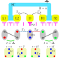

# Interfacing QuTip

The [QuTip python package](https://qutip.readthedocs.io/en/stable/) is a widely used package to simulate for example the time evolution of quantum systems. While QuTip offers options [to create quantum objects directly](https://qutip.readthedocs.io/en/stable/guide/guide-basics.html) the process can be tedious and hacky. `second_quantization` fills this gap by being able to translate between `sympy` objects and consistent matrix representations, the latter which can be readily wrapped as QuTip native `Qobj` objects.

In this tutorial we will give an example of that in the form of the minimal braiding protocol as presented in [this recent paper](https://doi.org/10.48550/arXiv.2501.16056). Specifically we will calculate the time evolution of the expectation values of local fermionic parities and fidelity having built each using the tools from `second_quatization`. An illustration of the system and protocol is appended below



The system consists of two minimal Kitaev chains coupled via an electronic dot in the middle. At $\pi$ phase difference between the superconductors the system implements a virtual T-junction as illustrated in the centered schematic that shows the system in the Majorana basis representation. Once the system is tuned to a T-junction, we can proceed with braiding the Majoranas by ramping the chemical potential of the electronic dot, and the couplings between the dot and the chains.

We will demonstrate how to:

1. Construct the symbolic representation using `sympy`'s fermionic operators
2. Convert them to a consistent matrix representation
3. Wrap the created elements as QuTip's `Qobj`
4. Compute relevant time evolutions

```python
from IPython.display import display
import matplotlib.pyplot as plt

# symbolic tools
import sympy
from sympy.physics.quantum.fermion import FermionOp
from sympy.physics.quantum import Dagger

# Numerical tools
import numpy as np
import matplotlib.pyplot as plt
from scipy.sparse.linalg import eigsh

# Second-quantization package
from second_quantization import hilbert_space

# QuTip
import qutip
```

## Setting up the Hamiltonian

We begin by setting up the ferionic operators $c_i$ where $i$ describes to the referred site. We furthermore define the parameters relevant for the calculation.

```python
# set-up symbolic fermionic operators
cL1,cL2,cM,cR1,cR2 = fermions = [FermionOp(name) for name in ['c_{L1}', 'c_{L2}', 'c_{M}', 'c_{R1}', 'c_{R2}']]

# set up parameters
mu_L1, mu_L2, t_L, Delta_L = sympy.symbols(
    r"\mu_{L1} \mu_{L2} t_L \Delta_L", real=True, commutative=True
)
mu_R1, mu_R2, t_R, Delta_R = sympy.symbols(
    r"\mu_{R1} \mu_{R2} t_R \Delta_R", real=True, commutative=True
)
mu_M, t_LM, t_MR = sympy.symbols(
    r"\mu_M t_{LM} t_{RM}", real=True, commutative=True
)
```

We now define the Hamiltonians that constitute the system. Specifically, these are two minimal Kitaev chains each described by

$$ H_{a}= \sum_{i=1,2} \mu_{ai}n_{ai} + t_{a}c^\dagger_{a2} c_{a1} + \Delta_{a}c_{a2} c_{a1} + h.c., $$

where $n_i=c_i^\dagger c_i$, and an electronic quantum dot

$$ H_D = \mu_D n_D. $$

The two chains are coupled to the electronic dot via the tunneling terms

$$ H_{\rm{tunnel}} = \Gamma_L c^\dagger_D c_{L2} + \Gamma_R c^\dagger_D c_{R1} + h.c., $$

```python
# set up the Hamiltonian

H_L = (
    mu_L1 * Dagger(cL1) * cL1
    + mu_L2 * Dagger(cL2) * cL2
    + t_L * Dagger(cL1) * cL2
    + t_L * Dagger(cL2) * cL1
    + Delta_L * Dagger(cL1) * Dagger(cL2)
    + Delta_L * cL2 * cL1
)

H_R = (
    mu_R1 * Dagger(cR1) * cR1
    + mu_R2 * Dagger(cR2) * cR2
    + t_R * Dagger(cR1) * cR2
    + t_R * Dagger(cR2) * cR1
    + Delta_R * Dagger(cR1) * Dagger(cR2)
    + Delta_R * cR2 * cR1
)

H_M = mu_M * Dagger(cM) * cM

H_LM = t_LM * Dagger(cL2) * cM + t_LM * Dagger(cM) * cL2
H_MR = t_MR * Dagger(cM) * cR1 + t_MR * Dagger(cR1) * cM

H_full = H_L + H_M + H_R + H_LM + H_MR
```

We can now have a look at the Hamiltonian we created and perform some sanity checks, e.g., whether the Hamiltonian is hertmitian.

```python
display(H_full)

display(sympy.simplify(sympy.expand(H_full)
                       - sympy.expand(Dagger(H_full))))
```

We now convert the Hamiltonians to matrices using `second_quantization`. For later evaluation with QuTip, we want the time dependent parts separated from the constant terms.

We furthermore choose the parameters of the constant part of the Hamiltonians, namely $H_{TPMM}=H_L+H_R$. The natural energy scale in this scenario is the coupling strength between the chains and the electronic dot, i.e. $\Gamma_i$ which we choose both to maximally reach unit magnitude.

In addition, we want to be able to ignore excited states of the system. Hence, we have to choose the gap on the two Kitaev chains to be large enough such as to be negligible.

Lastly, to realize the virtual T-junction depicted in the figure above faithfully, we implement a $\pi$-phase difference between the superconductors of the system by gauging the pairing in the right Kitaev chain to feature a minus sign, i.e. $\Delta_L=-\Delta_R=E_{gap}/2$

```python
E_gap = 10

sweet_spot_parameters = {mu_L1: 0, mu_L2: 0,
                         t_L: E_gap/2, Delta_L: E_gap/2,
                         mu_R1: 0, mu_R2: 0,
                         t_R: E_gap/2, Delta_R: -E_gap/2,}

h_pmm = hilbert_space.to_matrix(H_L+H_R, operators=fermions, sparse=False)
h_pmm = np.sum([k.subs(sweet_spot_parameters)*v for k,v in h_pmm.items()], axis=0)

h_m = hilbert_space.to_matrix(H_M, operators=fermions, sparse=False)[mu_M]
h_lm = hilbert_space.to_matrix(H_LM, operators=fermions, sparse=False)[t_LM]
h_mr = hilbert_space.to_matrix(H_MR, operators=fermions, sparse=False)[t_MR]
```

## Observables

We now create a number of observables that are relevant to the system. These are the groundstate parity of the left and the right Kitaev chains, and the projector associated with the initial and final states to assess the fidelity of the braiding operation.

```python
# parity observables
P_L = 1j*(cL1 + Dagger(cL1))*(-1j)*(cL2 - Dagger(cL2))
P_R = 1j*(-1j)*(cR1 - Dagger(cR1))*(cL2 + Dagger(cL2))
P_M = 1 - 2 * Dagger(cM) * cM


# initial and final states
init_state = np.kron(np.array([-1,0,0,1]),np.kron(np.array([1,0]), np.array([1,0,0,1])))/2
final_state = -np.kron(np.array([0,-1,1,0]),np.kron(np.array([1,0]), np.array([0,-1,1,0])))/2

# convert to matrices
p_l = hilbert_space.to_matrix(P_L, operators=fermions, sparse=False)[1]
p_m = hilbert_space.to_matrix(P_M, operators=fermions, sparse=False)[1]
p_r = hilbert_space.to_matrix(P_R, operators=fermions, sparse=False)[1]

f_init = np.outer(init_state, init_state)
f_final = np.outer(final_state, final_state)
```

## Define time dependent parameter profiles

As final preparation step we create the time dependent parameter profiles. As depicted in the figure above, these are $\mu_M, t_{LM},$ and $t_{MR}$ which each ramp either up or down at the end of a time segment. We choose the profiles for each in the same way as done in [the previously cited paper](https://doi.org/10.48550/arXiv.2501.16056) to perform the evolution adiabatically.

```python
# define time-dependent profiles using the parameters from the paper
t_segment = 200.54
t_ramp = 21.21
res = 2e-1
t_0 = 0
t_fin = 6*t_segment

def tanh_profile(t,T,t_scale,offset):
    t=(t+offset)%(3*T)
    return 0.5+(np.tanh((t-T/2)/(t_scale))-np.tanh((t-3*T/2)/(t_scale))+np.tanh((t-7*T/2)/(t_scale)))/2

t_vals = np.linspace(t_0, t_fin, num=int((t_fin-t_0)/res))
mu_d = tanh_profile(t_vals%(3*t_segment), t_segment, t_ramp, t_segment)
t_lm = tanh_profile(t_vals%(3*t_segment), t_segment, t_ramp, 0)
t_mr = tanh_profile(t_vals%(3*t_segment), t_segment, t_ramp, -t_segment)
```

## Time evolution

Finally we can wrap everything up into `qutip`'s `Qobj` types and perform calculations! Preparing everything for QuTip is as easy as wrapping the matrix-vector representations of the Hamiltonians, observables, and states we just created. By specifying the `operators` argument consistently in each matrix creation step, we ensure that the matrices are compatible among each other. Finally, as visible in the creation of the initial and final states, the Kronecker product structure of `second_quatization` allows to manually introduce statevectors.

```python
static_ham = [qutip.Qobj(h_pmm)]

dynamic_terms = [h_m, h_lm, h_mr]
dynamic_params = [mu_d, t_lm, t_mr]

dynamic_ham = [[qutip.Qobj(term), param] for term, param in zip(dynamic_terms, dynamic_params)]

h_evo_obj = qutip.QobjEvo(static_ham + dynamic_ham, tlist = t_vals)
init_obj = qutip.Qobj(init_state)
obs_evo_obj = [qutip.Qobj(op) for op in [p_l, p_m, p_r, f_init, f_final]]
```

```python
time_evolution = qutip.sesolve(h_evo_obj, init_obj, t_vals, e_ops=obs_evo_obj)
```

```python
fig, ax = plt.subplots(3,1, figsize=(10, 5), sharex=True)

ax[0].plot(t_vals,time_evolution.expect[0], linewidth=2, color='b', label=r'$\mathcal{P}_{L}$')
ax[0].plot(t_vals,time_evolution.expect[1], linewidth=2, color='orange', label=r'$\mathcal{P}_{M}$')
ax[0].plot(t_vals,time_evolution.expect[2], linewidth=2, color='green', label=r'$\mathcal{P}_{R}$')
ax[0].set_ylabel(r'$\mathcal{P}_{i}$')
ax[0].legend(loc=5)

ax[1].plot(t_vals,time_evolution.expect[-2], label=r'$\mathcal{F}[|\psi_{init}\rangle]$', linewidth=2)
ax[1].plot(t_vals,time_evolution.expect[-1], label=r'$\mathcal{F}[|\psi_{fin}\rangle]$', linewidth=2)
ax[1].set_ylabel(r'$\mathcal{f}[|\psi\rangle]$')
ax[1].legend(loc=5)


ax[2].plot(t_vals, mu_d, label=r'$\mu_D$', linewidth=2)
ax[2].plot(t_vals, t_lm, label=r'$t_{LM}$', linewidth=2)
ax[2].plot(t_vals, t_mr, label=r'$t_{MR}$', linewidth=2)
ax[2].legend(loc=5)
ax[2].set_xlabel(r'$t$')
ax[2].set_xticks([i*t_segment for i in range(7)],
                 [fr'${i}T$'.format(i) for i in range(7)])
ax[2].set_xlim(t_0, t_fin)

for i in range(3):
    ax[i].grid(True)

fig.show()
```

We see, the exchange of the two Majorana zero modes and the associated change of the state of the system happen without fault.
