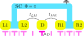
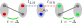
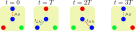

# Interfacing QuTiP

```python
from IPython.display import display
import matplotlib.pyplot as plt

# symbolic tools
import sympy
from sympy.physics.quantum.fermion import FermionOp
from sympy.physics.quantum import Dagger

# Numerical tools
import numpy as np
import matplotlib.pyplot as plt
from scipy.sparse.linalg import eigsh

# Second-quantization package
from second_quantization import hilbert_space

# QuTip
import qutip
```

The [QuTiP Python package](https://qutip.readthedocs.io/en/stable/) is widely used for simulating quantum systems, including time evolution.
For many-body models, building Hamiltonians by hand as matrices can be tedious.

`second_quantization` helps by converting symbolic `sympy` fermionic expressions into consistent matrix representations, which can then be wrapped as QuTiP `Qobj` objects.

We illustrate this on the minimal braiding protocol from [this paper](https://doi.org/10.48550/arXiv.2501.16056).

**Steps**

1. Build the Hamiltonian and observables symbolically (`sympy`).
2. Convert them to matrices in a consistent basis (`second_quantization`).
3. Wrap matrices/states as QuTiP objects (`Qobj`, `QobjEvo`).
4. Run the time evolution and interpret the plots (`sesolve`).

## Braiding protocol (minimal Kitaev chains)

The system consists of two minimal Kitaev chains coupled via a central quantum dot.

<figure markdown="span">
{ width="400" }
<figcaption>Device schematic</figcaption>
</figure>

When there is a $\pi$ phase difference between the superconductors, the system realizes the T-junction needed for braiding.

<figure markdown="span">
{ width="400" }
<figcaption>Majorana basis schematic</figcaption>
</figure>

Braiding is implemented by adiabatically ramping the dot chemical potential and its couplings to the chains.
Half a braiding protocol (shown in the image below) exchanges the Majorana modes between left and right chains.

<figure markdown="span">
{ width="400" }
<figcaption>Braiding protocol schematic</figcaption>
</figure>

A full braid corresponds to twice this sequence.

## Setting up the Hamiltonian

We start by defining the fermionic operators and symbolic parameters.

```python
# set-up symbolic fermionic operators
cL1,cL2,cM,cR1,cR2 = fermions = [FermionOp(name) for name in ['c_{L1}', 'c_{L2}', 'c_{M}', 'c_{R1}', 'c_{R2}']]

# set up parameters
mu_L1, mu_L2, t_L, Delta_L = sympy.symbols(
    r"\mu_{L1} \mu_{L2} t_L \Delta_L", real=True, commutative=True
)
mu_R1, mu_R2, t_R, Delta_R = sympy.symbols(
    r"\mu_{R1} \mu_{R2} t_R \Delta_R", real=True, commutative=True
)
mu_M, t_LM, t_MR = sympy.symbols(
    r"\mu_M t_{LM} t_{RM}", real=True, commutative=True
)
```

Next, we assemble the Hamiltonian in physically meaningful pieces (useful later for time dependence):

- the left Kitaev chain $H_L$,
- the right Kitaev chain $H_R$,
- the central quantum dot $H_M$,
- the coupling terms between the chains and the dot $H_{LM}$ and $H_{MR}$.

```python
# set up the Hamiltonian

H_L = (
    mu_L1 * Dagger(cL1) * cL1
    + mu_L2 * Dagger(cL2) * cL2
    + t_L * Dagger(cL1) * cL2
    + t_L * Dagger(cL2) * cL1
    + Delta_L * Dagger(cL1) * Dagger(cL2)
    + Delta_L * cL2 * cL1
)

H_R = (
    mu_R1 * Dagger(cR1) * cR1
    + mu_R2 * Dagger(cR2) * cR2
    + t_R * Dagger(cR1) * cR2
    + t_R * Dagger(cR2) * cR1
    + Delta_R * Dagger(cR1) * Dagger(cR2)
    + Delta_R * cR2 * cR1
)

H_M = mu_M * Dagger(cM) * cM

H_LM = t_LM * Dagger(cL2) * cM + t_LM * Dagger(cM) * cL2
H_MR = t_MR * Dagger(cM) * cR1 + t_MR * Dagger(cR1) * cM

H_full = H_L + H_M + H_R + H_LM + H_MR
```

For readability, we display each term:

```python
display(sympy.Eq(sympy.Symbol("H_{L}"), H_L))
display(sympy.Eq(sympy.Symbol("H_{R}"), H_R))
display(sympy.Eq(sympy.Symbol("H_{M}"), H_M))
display(sympy.Eq(sympy.Symbol("H_{LM}"), H_LM))
display(sympy.Eq(sympy.Symbol("H_{MR}"), H_MR))
```

We then convert to matrices with `second_quantization`.
We keep a static part $H_{TPMM}=H_L+H_R$ and treat the dot/couplings ($H_M, H_{LM}, H_{MR}$) as driven terms, matching QuTiP’s time-dependent Hamiltonian format.

To realize the virtual T-junction we impose a $\pi$ phase difference by choosing opposite pairing signs, $\Delta_L=-\Delta_R=E_{gap}/2$.

```python
E_gap = 10

sweet_spot_parameters = {
    mu_L1: 0, mu_L2: 0,
    t_L: E_gap/2, Delta_L: E_gap/2,
    mu_R1: 0, mu_R2: 0,
    t_R: E_gap/2, Delta_R: -E_gap/2,
    }
```

We convert each Hamiltonian component into its matrix representation:

```python
h_pmm = hilbert_space.to_matrix(H_L+H_R, operators=fermions, sparse=False)
h_pmm = np.sum(
    [k.subs(sweet_spot_parameters)*v for k,v in h_pmm.items()], axis=0
    )

h_m = hilbert_space.to_matrix(H_M, operators=fermions, sparse=False)[mu_M]
h_lm = hilbert_space.to_matrix(H_LM, operators=fermions, sparse=False)[t_LM]
h_mr = hilbert_space.to_matrix(H_MR, operators=fermions, sparse=False)[t_MR]
```

## Observables

We track (i) local parities and (ii) fidelity with respect to chosen initial/final target states.
In QuTiP these become `e_ops`, so expectations are recorded at every time.

```python
# parity observables
P_L = 1j*(cL1 + Dagger(cL1))*(-1j)*(cL2 - Dagger(cL2))
P_R = 1j*(-1j)*(cR1 - Dagger(cR1))*(cL2 + Dagger(cL2))
P_M = 1 - 2 * Dagger(cM) * cM

# convert to matrices
p_l = hilbert_space.to_matrix(P_L, operators=fermions, sparse=False)[1]
p_m = hilbert_space.to_matrix(P_M, operators=fermions, sparse=False)[1]
p_r = hilbert_space.to_matrix(P_R, operators=fermions, sparse=False)[1]
```

To track the evolution of the system's state, we define the initial and final target states as kets and compute their corresponding density matrices.
These states are:

- Initial state: $|\psi_{init}\rangle = \frac{1}{2}|E_+\rangle|0\rangle |E_-\rangle$
- Final state: $|\psi_{final}\rangle = \frac{1}{2}|O_-\rangle|0\rangle |O_-\rangle$

Here $|E_{\pm}\rangle = \frac{1}{\sqrt{2}}(|0\rangle \pm |1,1\rangle)$ and $|O_{\pm}\rangle = \frac{1}{\sqrt{2}}(|1,0\rangle \pm |0,1\rangle)$ are the even and odd parity ground states of the left/right chains, respectively, and $|0\rangle$ is the empty state of the central dot.
Ideally, a transformation from the initial to the final state corresponds to a full braid of the Majorana modes.

We write these states as:
```python
# initial and final states
init_state = np.kron(np.array([-1,0,0,1]),np.kron(np.array([1,0]), np.array([1,0,0,1])))/2
final_state = -np.kron(np.array([0,-1,1,0]),np.kron(np.array([1,0]), np.array([0,-1,1,0])))/2

f_init = np.outer(init_state, init_state)
f_final = np.outer(final_state, final_state)
```

## Define time dependent parameter profiles

The protocol is implemented by smooth ramps of $\mu_M$, $t_{LM}$, and $t_{MR}$.
We use the same “tanh” profiles as in [the paper](https://doi.org/10.48550/arXiv.2501.16056) to stay close to adiabatic evolution.


```python
# define time-dependent profiles using the parameters from the paper
t_segment = 200.54
t_ramp = 21.21
res = 2e-1
t_0 = 0
t_fin = 6*t_segment

def tanh_profile(t,T,t_scale,offset):
    t=(t+offset)%(3*T)
    return 1/2+(np.tanh((t-T/2)/(t_scale))-np.tanh((t-3*T/2)/(t_scale))+np.tanh((t-7*T/2)/(t_scale)))/2

t_vals = np.linspace(t_0, t_fin, num=int((t_fin-t_0)/res))
mu_d = tanh_profile(t_vals%(3*t_segment), t_segment, t_ramp, t_segment)
t_lm = tanh_profile(t_vals%(3*t_segment), t_segment, t_ramp, 0)
t_mr = tanh_profile(t_vals%(3*t_segment), t_segment, t_ramp, -t_segment)
```

```python
# plot the time-dependent profiles
fig, ax = plt.subplots(figsize=(8, 3))

ax.plot(t_vals/t_segment, mu_d, label=r'$\mu_M$', linewidth=2)
ax.plot(t_vals/t_segment, t_lm, '--', label=r'$t_{LM}$', linewidth=2)
ax.plot(t_vals/t_segment, t_mr, '-.', label=r'$t_{MR}$', linewidth=2)
ax.set_ylabel('Parameter value')
ax.set_xlabel(r'$t/T$')
```

## Time evolution (QuTiP)

Now we run a time-dependent Schrödinger evolution.

**Wrapping rule:** matrices and state vectors must be wrapped as `qutip.Qobj` before they can be used by QuTiP solvers.

```python
static_ham = [qutip.Qobj(h_pmm)]

dynamic_terms = [h_m, h_lm, h_mr]
dynamic_params = [mu_d, t_lm, t_mr]

dynamic_ham = [
    [qutip.Qobj(term), param] for term, param in zip(dynamic_terms, dynamic_params)
    ]

h_evo_obj = qutip.QobjEvo(static_ham + dynamic_ham, tlist = t_vals)
init_obj = qutip.Qobj(init_state)
obs_evo_obj = [qutip.Qobj(op) for op in [p_l, p_m, p_r, f_init, f_final]]
```

The required objects are now ready:

- `h_evo_obj` is the combined time-dependent Hamiltonian \(H(t)\).
- `init_obj` is the initial state \(|\psi_{init}\rangle\).
- `obs_evo_obj` contains the operators whose expectation values we want to record.

We now perform the time evolution: 

```python
time_evolution = qutip.sesolve(h_evo_obj, init_obj, t_vals, e_ops=obs_evo_obj)
```

`sesolve` returns expectation values in the same order as `e_ops`.
Here that means parities first (`p_l`, `p_m`, `p_r`), then fidelities (`f_init`, `f_final`).

```python
fig, ax = plt.subplots(2,1, figsize=(8, 5))

ax[0].plot(t_vals/t_segment,time_evolution.expect[0], linewidth=2, color='b', label=r'$\mathcal{P}_{L}$')
ax[0].plot(t_vals/t_segment,time_evolution.expect[1], linewidth=2, color='orange', label=r'$\mathcal{P}_{M}$')
ax[0].plot(t_vals/t_segment,time_evolution.expect[2], linewidth=2, color='green', label=r'$\mathcal{P}_{R}$')
ax[0].set_ylabel(r'$\mathcal{P}_{i}$')
ax[0].legend(loc=5)

ax[1].plot(t_vals/t_segment,time_evolution.expect[-2], label=r'$\mathcal{F}[|\psi_{init}\rangle]$', linewidth=2)
ax[1].plot(t_vals/t_segment,time_evolution.expect[-1], label=r'$\mathcal{F}[|\psi_{fin}\rangle]$', linewidth=2)
ax[1].set_ylabel(r'$\mathcal{f}[|\psi\rangle]$')
ax[1].legend(loc=5)

ax[0].set_xticklabels([])
ax[1].set_xlabel(r'$t/T$')


fig.show()
```

How to read this figure:

- **Parities (top):** track how local fermionic parity is redistributed during the ramps.
- **Fidelities (bottom):** $\mathcal{F}[|\psi_{init}\rangle]$ drops as the state leaves the start, while $\mathcal{F}[|\psi_{fin}\rangle]$ rises if the protocol reaches the target.

Together with the parameter-profile plot, these curves give a compact check that the ramps implement the intended braid.
